# KaraVan Kontrol Paneli · Kullanım Kılavuzu

**Kart yazılımı sürüm 1.0 · Android uygulaması sürüm 1.2**

KaraVan, karavanınızdaki Webasto ısıtıcıyı otomatik çalıştıran ve gaz, duman ve hırsız alarmlarını izleyen bir kontrol kartıdır. Kart kendi Wi-Fi ağını yayınlar. Telefonunuzu bu ağa bağlayıp tarayıcıdan ya da KaraVan uygulamasından kontrol edersiniz. İnternet gerekmez.

## İçindekiler

1. [İlk bağlantı](#1-ilk-bağlantı)
2. [Isıtma](#2-ısıtma)
3. [Güvenlik ve hırsız alarmı](#3-güvenlik-ve-hırsız-alarmı)
4. [İkazlar ve sesler](#4-ikazlar-ve-sesler)
5. [Olaylar](#5-olaylar)
6. [Ayarlar](#6-ayarlar)
7. [Android uygulaması ve telefon bildirimleri](#7-android-uygulaması-ve-telefon-bildirimleri)
8. [Kart üzerindeki LED ve BOOT düğmesi](#8-kart-üzerindeki-led-ve-boot-düğmesi)
9. [Sorun giderme](#9-sorun-giderme)
10. [Fabrika değerleri ve teknik bilgiler](#10-fabrika-değerleri-ve-teknik-bilgiler)

---

## 1. İlk bağlantı

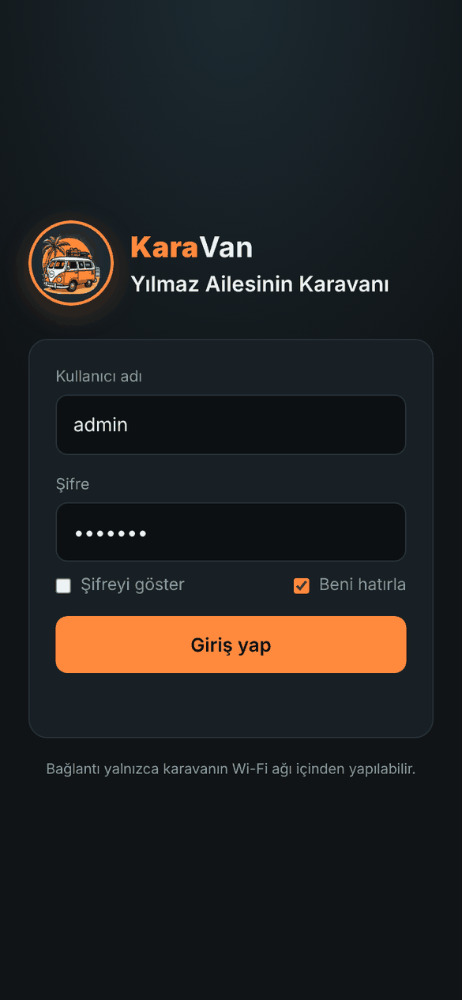

1. Telefonun Wi-Fi ayarlarını açın ve **KaraVan-XXXX** ağına bağlanın. XXXX karta özel dört karakterdir.
   - Fabrika Wi-Fi şifresi: **karavan2026**
2. Telefon "Bu ağda internet yok" diye sorarsa **bağlı kal**'ı seçin.
3. Giriş sayfası genellikle kendiliğinden açılır. Açılmazsa tarayıcıya **192.168.4.1** yazın.
4. Giriş bilgileriyle oturum açın.
   - Fabrika kullanıcı adı: **admin**
   - Fabrika şifresi: **karavan**
   - **Beni hatırla**'yı işaretlerseniz 30 gün boyunca yeniden şifre sorulmaz.

> **İlk iş:** Ayarlar bölümünden hem giriş şifresini hem Wi-Fi şifresini değiştirin.

Art arda 5 kez yanlış şifre girilirse giriş 60 saniye kilitlenir. Unuttuysanız [BOOT düğmesiyle sıfırlayabilirsiniz](#8-kart-üzerindeki-led-ve-boot-düğmesi).

Ekranın altında dört sekme vardır: **Isıtma**, **Güvenlik**, **Olaylar** ve **Ayarlar**. Sağ üstteki yeşil nokta ve "bağlı" yazısı kartla bağlantının sürdüğünü gösterir.

 

---

## 2. Isıtma

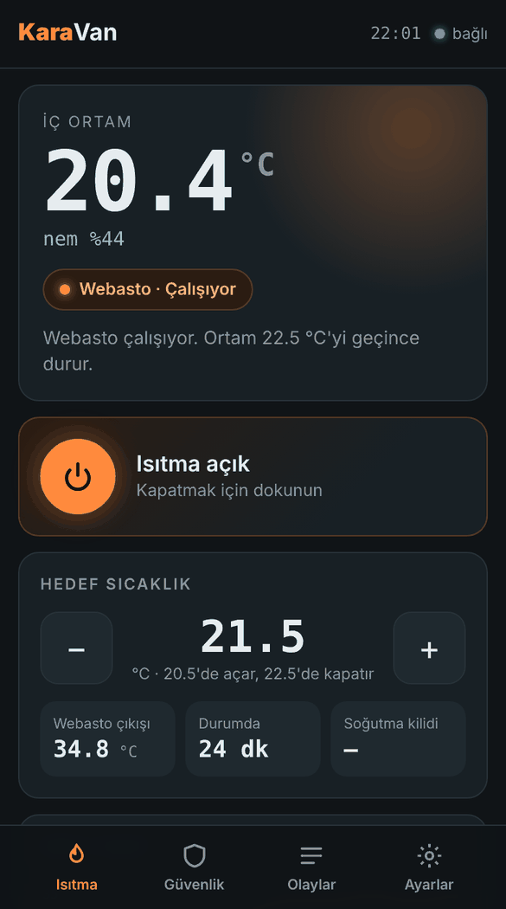

Kart iç ortam sıcaklığını ölçer. Sıcaklık hedefin altına düşünce Webasto'yu başlatır, hedefin üstüne çıkınca durdurur. Bunun için Webasto'nun düğmesine 1 saniye basar.

Webasto düğmesi her basışta aç/kapa yaptığı için kart, Webasto'nun gerçekten çalışıp çalışmadığını **Webasto çıkışındaki ikinci sensörle** kontrol eder:

- Çıkış ısınıyorsa Webasto çalışıyordur.
- Çıkış soğuyorsa Webasto durmuştur.

**Ekrandaki bölümler:**

| Bölüm | Ne gösterir / ne yapar |
| --- | --- |
| İç ortam | Karavanın içindeki sıcaklık ve nem; Webasto'nun durumu ve kısa açıklaması |
| Isıtma açık / kapalı | Otomatik ısıtmayı açar ya da kapatır. Kapalıyken Webasto hiç başlatılmaz |
| Hedef sıcaklık | **−** / **+** ile istediğiniz sıcaklık (5–30 °C). Altındaki satır Webasto'nun hangi sıcaklıkta açılıp kapanacağını gösterir |
| Webasto çıkışı | Webasto üfleme ağzındaki sıcaklık |
| Durumda | Webasto'nun bu durumda ne kadar süredir olduğu |
| Soğutma kilidi | Webasto durduktan sonra yeniden başlatılmadan önce kalan bekleme süresi |
| Son 2 saat | İç ortam (mavi) ve Webasto çıkışı (turuncu) sıcaklık grafiği; kesik çizgi hedef |

**Örnek:** Hedef 21,5 °C ve açma-kapama aralığı ±1 °C ise, Webasto ortam 20,5 °C'ye düşünce başlar, 22,5 °C'ye çıkınca durur.

> Kart her açıldığında **ısıtma kapalı** başlar. Elektrik kesilip geldiğinde Webasto kendiliğinden çalışmaz; ısıtmayı yeniden açmanız gerekir.

 

### Webasto durumları

<table>
<tr>
<td align="center">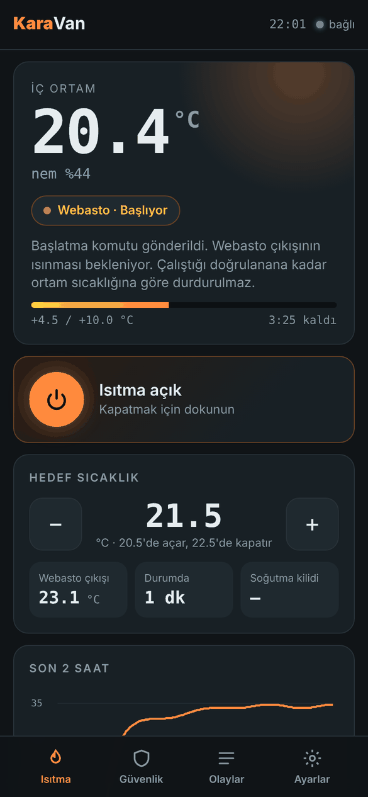 <b>Başlıyor</b></td>
<td align="center">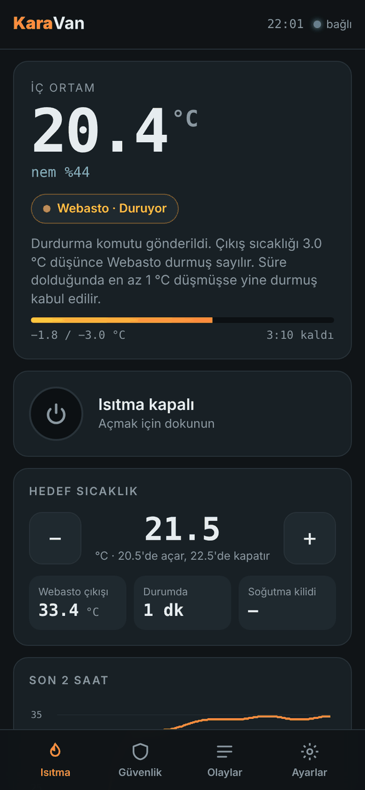 <b>Duruyor</b></td>
<td align="center">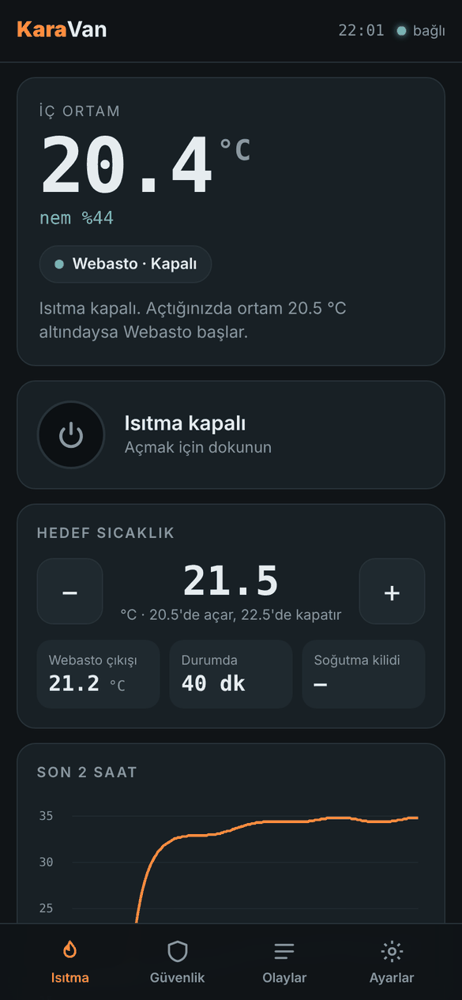 <b>Kapalı</b></td>
<td align="center">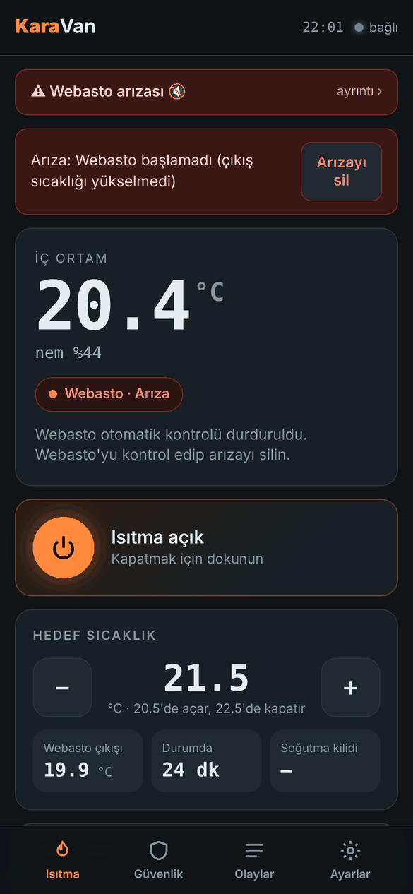 <b>Arıza</b></td>
</tr>
</table>

| Durum | Anlamı |
| --- | --- |
| **Kapalı** | Webasto çalışmıyor |
| **Başlıyor** | Başlatma komutu gönderildi. Kart çıkışın ısınmasını bekliyor; çubuk ısınmanın ne kadarının tamamlandığını ve kalan süreyi gösterir |
| **Çalışıyor** | Çıkış ısındı, Webasto çalışıyor |
| **Duruyor** | Durdurma komutu gönderildi. Kart çıkışın soğumasını bekliyor; çubuk soğuma ilerlemesini gösterir |
| **Arıza** | Webasto beklendiği gibi başlamadı ya da durmadı. Otomatik kontrol durur |
| **Bilinmiyor** | Kart yeni açıldı, durum henüz anlaşılmadı |

**Başlatma:** Kart düğmeye basar ve çıkışın 5 dakika içinde 10 °C ısınmasını bekler.

- En az 3 °C ısındıysa Webasto yavaş da olsa çalışıyor kabul edilir.
- Hiç ısınmadıysa bir kez daha dener.
- Yine olmazsa **Arıza** verir.

**Durdurma:** Kart düğmeye basar ve çıkışın 5 dakika içinde en yüksek değerinden 3 °C soğumasını bekler.

- Webasto'nun fanı durduktan sonra bir süre ılık hava üflemeye devam eder. Bu yüzden süre sonunda en az 1 °C soğuma yeterli sayılır.
- Hiç soğumadıysa **Arıza** verir. Webasto'yu yanlışlıkla yeniden çalıştırmamak için ikinci kez düğmeye **basmaz**.

Bu süreleri ve sıcaklık farklarını [Ayarlar > Isıtma](#isıtma)'dan değiştirebilirsiniz.

**Arıza olduğunda:**

1. Webasto'yu kontrol edin: yakıt, sigorta, Webasto'nun kendi arıza kodu.
2. Webasto'nun gerçekte açık mı kapalı mı olduğuna bakın.
3. Ekrandaki **Arızayı sil** düğmesine basın. Otomatik kontrol yeniden başlar.

**Koruma süreleri:**

- **En kısa çalışma:** Webasto başlayınca, hedef aşılsa bile en az 10 dakika çalışır. Sık aç-kapa Webasto'yu yıpratır ve bujiyi kurumla doldurur.
- **Soğutma kilidi:** Webasto durduktan sonra 3 dakika yeniden başlatılmaz.

---

## 3. Güvenlik ve hırsız alarmı

<table>
<tr>
<td align="center">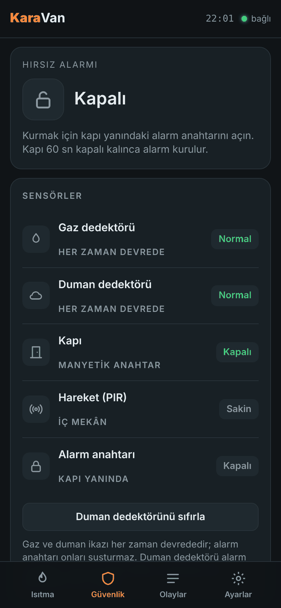 <b>Kapalı</b></td>
<td align="center">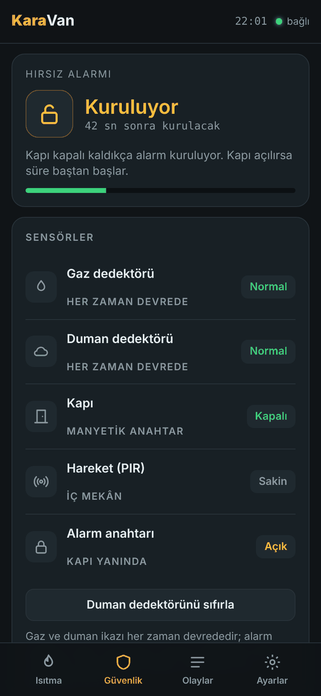 <b>Kuruluyor</b></td>
<td align="center">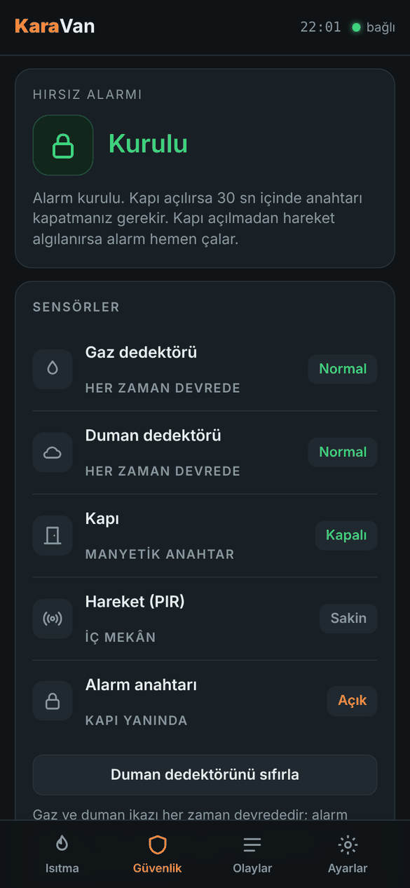 <b>Kurulu</b></td>
<td align="center">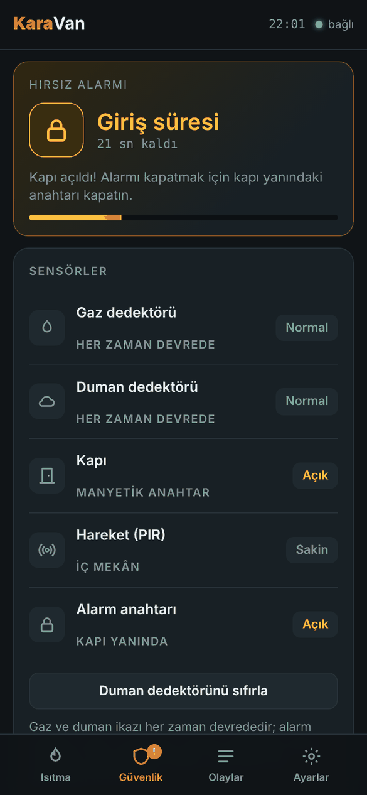 <b>Giriş süresi</b></td>
</tr>
</table>

Hırsız alarmı kapının yanındaki, karavanın içinde duran **alarm anahtarıyla** kurulur ve kapatılır. Telefondan kurulmaz; bu bilerek böyle tasarlandı.

**Alarmı kurmak:**

1. Alarm anahtarını açın.
2. Dışarı çıkıp kapıyı kapatın.
3. Kapı **60 saniye** kapalı kalınca alarm kurulur. Ekranda geri sayım görünür. Bu süre içinde kapı açılırsa sayım baştan başlar.

**Alarm kuruluyken:**

- Kapı açılırsa **30 saniyelik giriş süresi** başlar. Kart saniyede bir bip çalar, son 10 saniyede hızlanır. Bu sürede içeri girip anahtarı kapatın.
- Anahtar kapatılmazsa alarm çalar.
- Kapı açılmadan içeride hareket algılanırsa (örneğin pencereden giriş) alarm **hemen** çalar.
- Kapının açılması tek başına alarm sebebi değildir. Alarm için hareket sensörünün de hareket görmesi gerekir. Hareket sensörü kısa titreşimlere karşı süzgeçlidir: hareket 2 saniye sürmeli ya da 30 saniye içinde iki kez görülmelidir.

**Alarm çalınca:**

- Kartın buzzer'ı ve gaz dedektörünün sireni 3 dakika boyunca çalar. Yeni hareket algılanırsa siren yeniden başlar.
- Alarm anahtarını kapatmak sireni **hemen** susturur.

**Sensörler listesi:** Gaz dedektörü, duman dedektörü, kapı, hareket sensörü ve alarm anahtarının anlık durumunu gösterir.

> **Gaz ve duman alarmları her zaman devrededir.** Alarm anahtarı onları kapatmaz ve susturmaz.

---

## 4. İkazlar ve sesler

<table>
<tr>
<td align="center">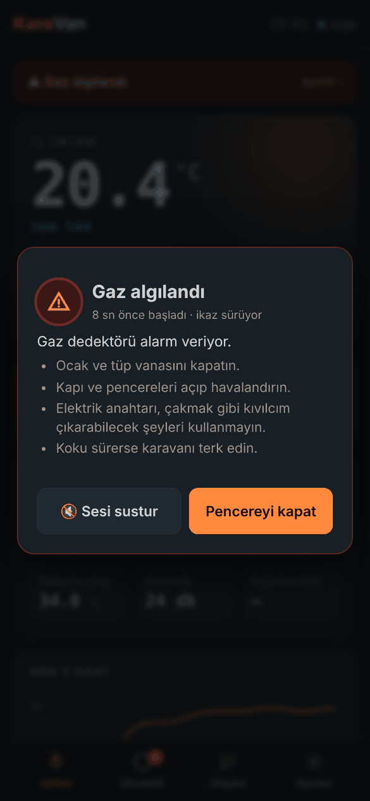 <b>Gaz</b></td>
<td align="center">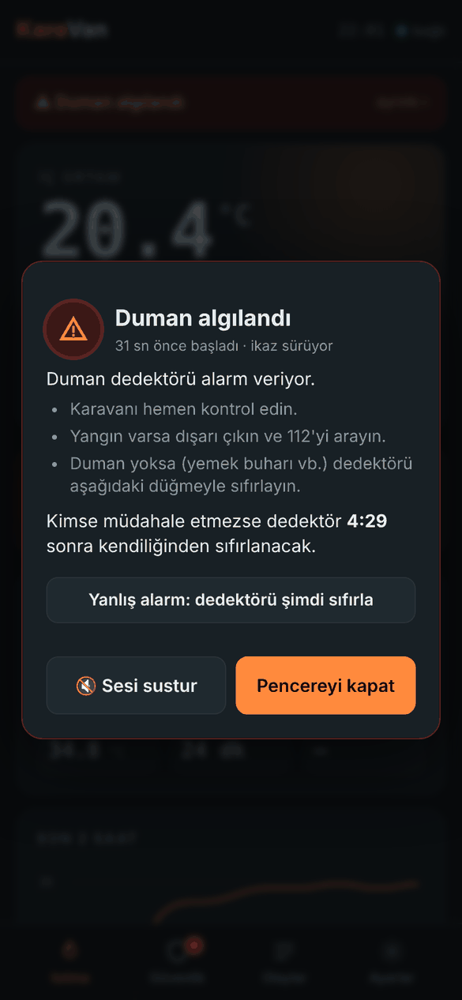 <b>Duman</b></td>
<td align="center">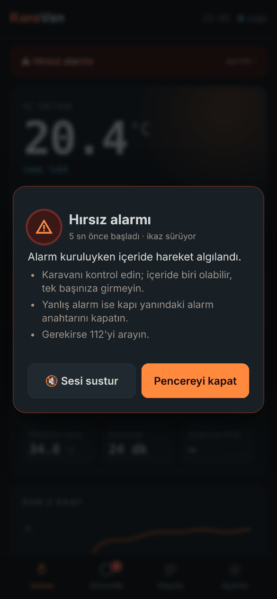 <b>Hırsız</b></td>
</tr>
</table>

Bir ikaz oluşunca ekranda ne yapmanız gerektiğini anlatan bir pencere açılır. Penceredeki iki düğme:

- **Sesi sustur:** Kartın buzzer'ını bu ikaz için susturur. Yeni bir ikaz gelirse ses yeniden çalar.
- **Pencereyi kapat:** Pencereyi kapatır. Aynı ikaz için pencere tekrar açılmaz, ama ekranın üstündeki kırmızı şerit ikaz bitene kadar kalır.

| İkaz | Kartın sesi |
| --- | --- |
| Gaz, duman, hırsız | Sürekli kesik siren |
| Webasto arızası, sensör okunamıyor | İkaz başlarken çift bip, sonra 30 saniyede bir çift bip |
| Hırsız alarmı giriş süresi | Saniyede bir bip, son 10 saniyede hızlı bip |

### Duman dedektörünü sıfırlama

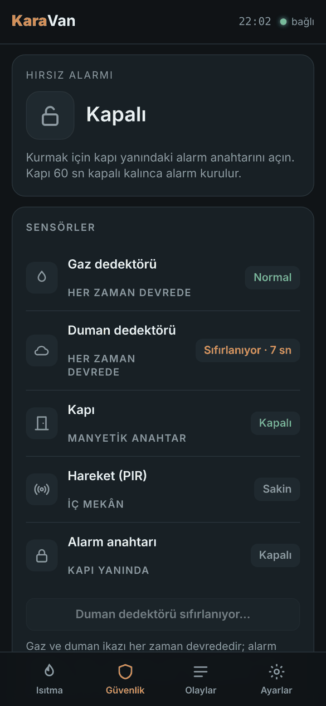

Duman dedektörü alarm verince kendini kilitler ve ancak beslemesi kesilip verilince susar. Kart bu işi iki yoldan yapar:

**Elle sıfırlama:** Yemek buharı gibi yanlış bir alarmda duman ikazı penceresindeki **Yanlış alarm: dedektörü şimdi sıfırla** düğmesine ya da Güvenlik sekmesindeki **Duman dedektörünü sıfırla** düğmesine basın. Sonra şunlar olur:

1. Dedektörün beslemesi 10 saniye kesilir.
2. Dedektör açılırken 30 saniye daha dinlenmez.
3. Bu sırada ekranda "Sıfırlanıyor" yazar.
4. Duman hâlâ varsa ikaz yeniden başlar.

**Otomatik sıfırlama:** Kimse müdahale etmezse kart, duman ikazı **5 dakika** sürdükten sonra dedektörü kendisi sıfırlar ve yeniden dinlemeye başlar. Duman sürüyorsa ikaz geri gelir ve süre baştan sayılır. Kalan süre ikaz penceresinde görünür. Süreyi [Ayarlar > Duman dedektörü](#duman-dedektörü)'nden değiştirebilir ya da kapatabilirsiniz.

> Sıfırlama sırasında yaklaşık 40 saniye duman algılanmaz. Gerçek duman varsa sıfırlamayın.

 

### Gaz ikazında

Gaz dedektörünün kendi sesi de çalar. Tüp vanasını kapatın, kapı ve pencereleri açın, elektrik anahtarı ya da çakmak gibi kıvılcım çıkarabilecek şeyleri kullanmayın. Koku sürerse karavanı terk edin.

---

## 5. Olaylar

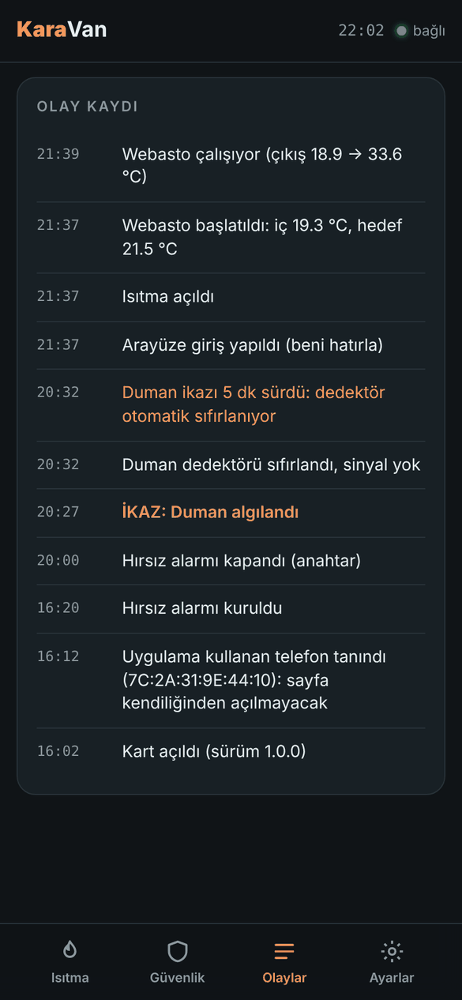

Kartın yaptığı ve gördüğü her şeyin kaydı burada tutulur: Webasto'nun başlaması ve durması, ikazlar, alarmın kurulması, girişler, ayar değişiklikleri.

- Kırmızı satırlar alarmdır.
- Sarı satırlar uyarıdır.
- Yeni olay varken sekmede bir işaret görünür.

Kayıt en son 60 olayı tutar. Kart kapanınca silinir.

> Saatler telefonunuzdan alınır. Karta giriş yaptığınızda kartın saati telefonla eşitlenir.

 

---

## 6. Ayarlar

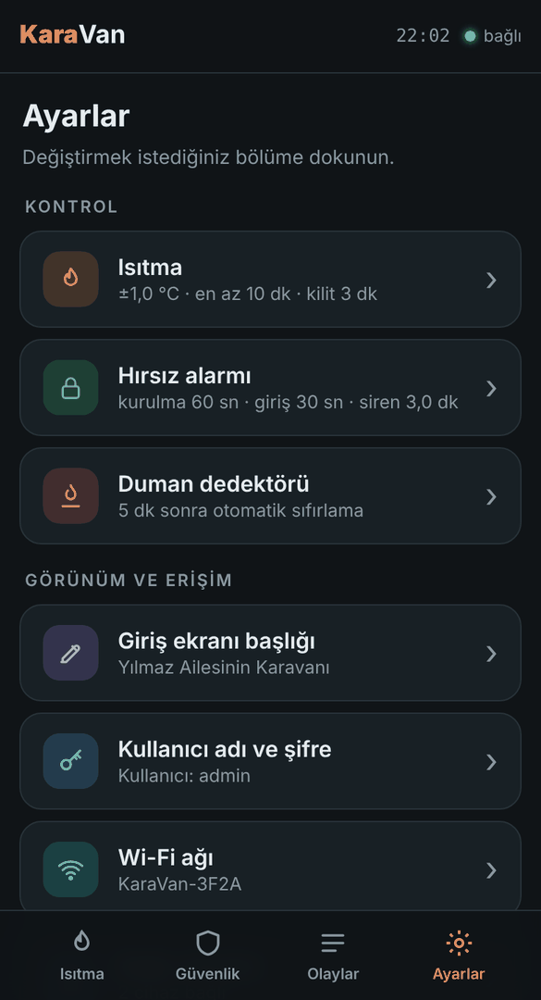

Ayarlar bölümlere ayrılmıştır; bir bölüme dokununca açılır.

Sayısal ayarlar **−** / **+** düğmeleriyle değiştirilir. Basılı tutarsanız değer hızlı değişir. Değiştirdiğiniz değer turuncu görünür.

**Kaydet**'e basmadan hiçbir ayar karta yazılmaz. Kaydedilen ayarlar elektrik kesilince de korunur.

 

### Isıtma

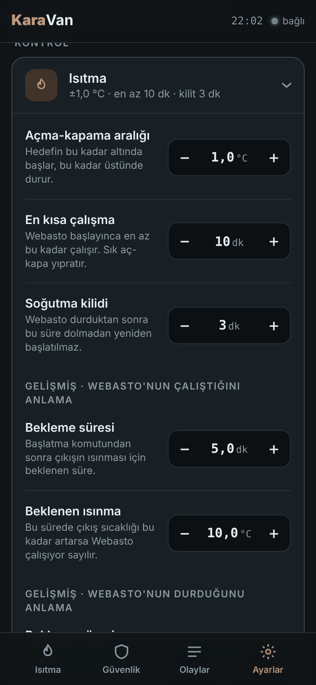

| Ayar | Açıklama | Aralık | Fabrika |
| --- | --- | --- | --- |
| Açma-kapama aralığı | Hedefin bu kadar altında başlar, bu kadar üstünde durur | 0,3–5 °C | 1 °C |
| En kısa çalışma | Webasto başlayınca en az bu kadar çalışır | 0–30 dk | 10 dk |
| Soğutma kilidi | Webasto durduktan sonra bu süre dolmadan yeniden başlatılmaz | 0–15 dk | 3 dk |
| *Webasto'nun çalıştığını anlama:* Bekleme süresi | Başlatmadan sonra çıkışın ısınması için beklenen süre | 1–20 dk | 5 dk |
| *Webasto'nun çalıştığını anlama:* Beklenen ısınma | Bu kadar ısınırsa Webasto çalışıyor sayılır | 2–30 °C | 10 °C |
| *Webasto'nun durduğunu anlama:* Bekleme süresi | Durdurmadan sonra çıkışın soğuması için beklenen süre | 1–20 dk | 5 dk |
| *Webasto'nun durduğunu anlama:* Beklenen soğuma | Çıkış en yüksek değerinden bu kadar düşerse Webasto durmuş sayılır | 1–15 °C | 3 °C |

> Webasto çalıştığı hâlde sık sık **Arıza** görüyorsanız:
> - Arıza başlatmada oluyorsa "Beklenen ısınma"yı azaltın ya da "Bekleme süresi"ni uzatın.
> - Arıza durdurmada oluyorsa "Beklenen soğuma"yı azaltın.
>
> Çıkış sensörü Webasto ağzından uzaktaysa küçük değerler daha uygundur.

 

### Hırsız alarmı

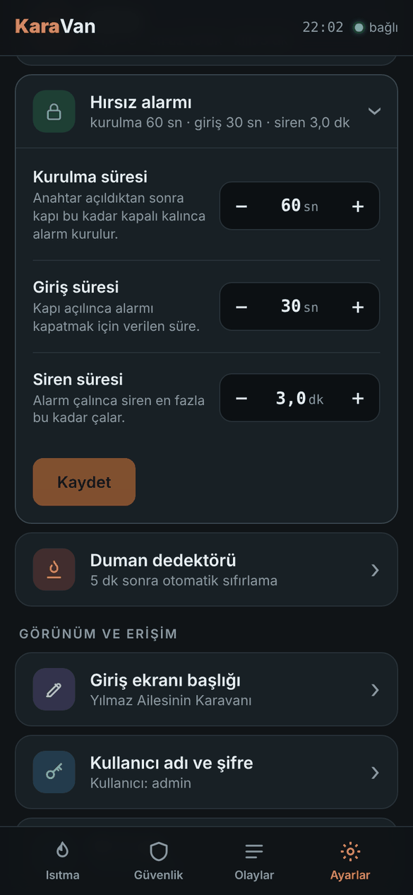

| Ayar | Açıklama | Aralık | Fabrika |
| --- | --- | --- | --- |
| Kurulma süresi | Anahtar açıldıktan sonra kapının kapalı kalması gereken süre | 10–300 sn | 60 sn |
| Giriş süresi | Kapı açılınca anahtarı kapatmak için verilen süre | 0–120 sn | 30 sn |
| Siren süresi | Alarm çalınca sirenin en fazla çalma süresi | 0,5–15 dk | 3 dk |

 

### Duman dedektörü

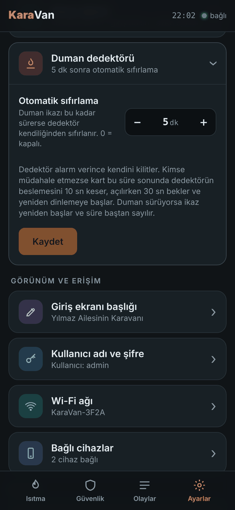

| Ayar | Açıklama | Aralık | Fabrika |
| --- | --- | --- | --- |
| Otomatik sıfırlama | Duman ikazı bu kadar sürerse dedektör kendiliğinden sıfırlanır. 0 = kapalı | 0–60 dk | 5 dk |

 

### Giriş ekranı başlığı, kullanıcı adı ve şifre

<table>
<tr>
<td align="center">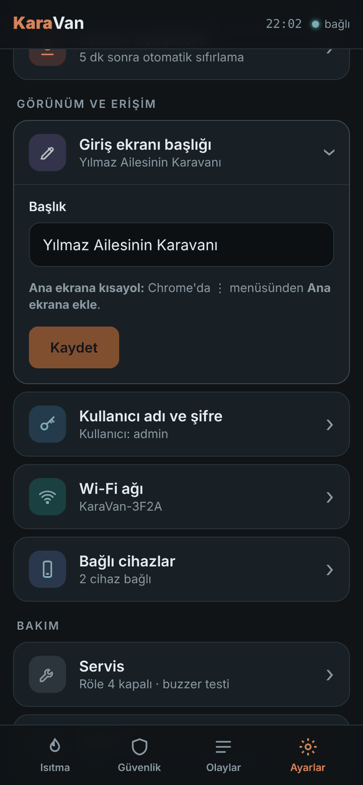</td>
<td align="center">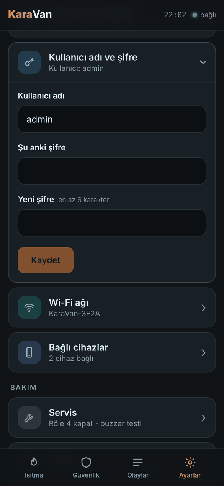</td>
</tr>
</table>

- **Giriş ekranı başlığı:** Giriş sayfasında logonun altında görünen yazı, örneğin "Yılmaz Ailesinin Karavanı".
- **Kullanıcı adı ve şifre:**
  - Değiştirmek için şu anki şifreyi de girmeniz gerekir.
  - Yeni şifre en az 6 karakter olmalıdır.
  - Şifre değişince açık olan diğer oturumlar kapanır.

### Wi-Fi ağı

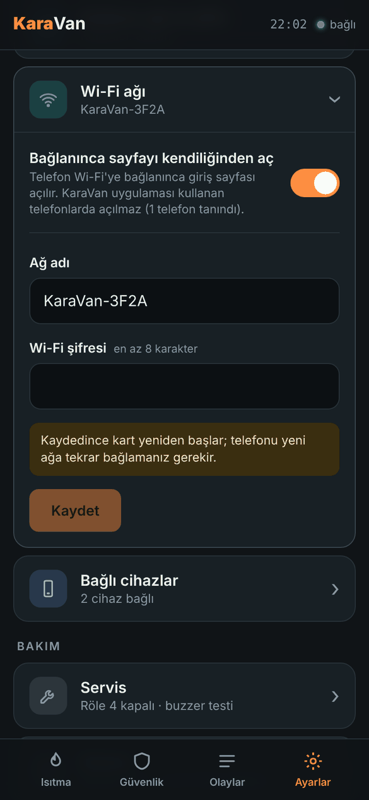

- **Bağlanınca sayfayı kendiliğinden aç:**
  - Açıkken, uygulaması olmayan bir telefon Wi-Fi'ye bağlanınca giriş sayfası kendiliğinden açılır.
  - KaraVan uygulamasını kullanan telefonları kart tanır ve onlarda sayfayı açmaz. Uygulama yüklü bir telefon karta ilk kez bağlandığında sayfa bir kez daha açılabilir; sonrakilerde açılmaz.
  - Kapalıyken sayfa hiçbir telefonda kendiliğinden açılmaz.
  - Bu ayar düğmeye dokununca hemen kaydedilir.
- **Ağ adı ve Wi-Fi şifresi:**
  - Wi-Fi şifresi en az 8 karakter olmalıdır.
  - Kaydedince kart yeniden başlar. Telefonu yeni ağ adına ve şifreye göre yeniden bağlamanız gerekir.

 

### Bağlı cihazlar, Servis, Sistem

<table>
<tr>
<td align="center">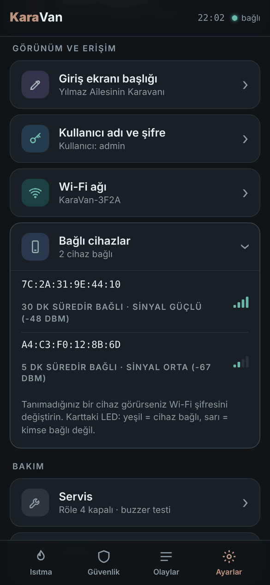 <b>Bağlı cihazlar</b></td>
<td align="center">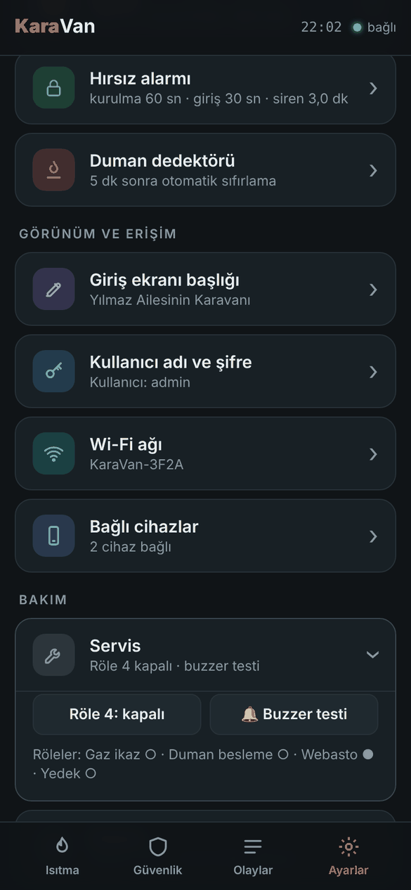 <b>Servis</b></td>
<td align="center">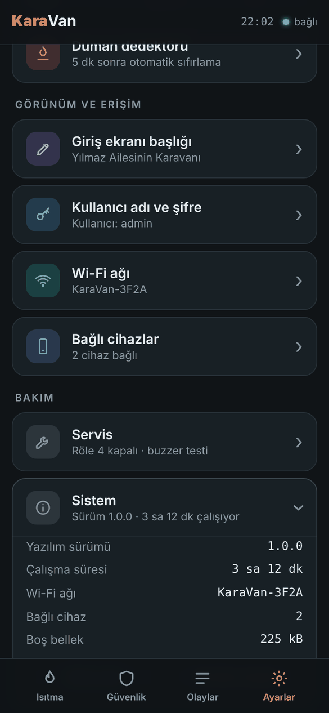 <b>Sistem</b></td>
</tr>
</table>

- **Bağlı cihazlar:**
  - Kartın Wi-Fi ağına bağlı telefonları, ne kadar süredir bağlı olduklarını ve sinyal güçlerini gösterir.
  - Kart en fazla 4 cihaza izin verir.
  - Tanımadığınız bir cihaz görürseniz Wi-Fi şifresini değiştirin.
- **Servis:**
  - Yedek röleyi (Röle 4) açıp kapatabilir, buzzer'ı deneyebilirsiniz.
  - Altta tüm rölelerin anlık durumu görünür.
- **Sistem:**
  - Yazılım sürümünü, çalışma süresini ve bellek durumunu gösterir.
  - **Çıkış yap** ve **Yeniden başlat** düğmeleri buradadır. Yeniden başlayan kartta ısıtma kapalı açılır.

---

## 7. Android uygulaması ve telefon bildirimleri

Tarayıcı yerine KaraVan uygulamasını kullanırsanız iki şey kazanırsınız:

- Panel tam ekran açılır.
- Telefon cebinizdeyken, uygulama kapalıyken bile ikazlar **telefon bildirimi** olarak gelir.

**Kurulum:**

1. Bu deponun **Releases** bölümünden en yeni `KaraVan.apk` dosyasını telefona indirin.
2. Dosyaya dokunun. Telefon "bilinmeyen kaynak" uyarısı verirse bu kaynaktan yüklemeye izin verin.
3. Uygulamayı açın.
   - **Bildirim izni** sorulduğunda **İzin ver**'i seçin.
   - **Pil tasarrufu muafiyeti** sorulduğunda **İzin ver**'i seçin.
4. Telefonu KaraVan Wi-Fi'sine bağlayıp giriş yapın. **Beni hatırla**'yı işaretleyin.

**Bildirimler nasıl çalışır:**

- Telefon KaraVan Wi-Fi'sine bağlıyken uygulama birkaç saniyede bir kartı kontrol eder.
- Yeni bir ikazda (gaz, duman, hırsız, Webasto arızası, sensör sorunu) telefonun **kendi bildirim sesiyle** tek bir bildirim gelir.
- Birden fazla ikaz varsa hepsi aynı bildirimde listelenir; bildirim alanı dolmaz.
- Bildirimdeki **Kartın sesini sustur** düğmesi kartın buzzer'ını uzaktan susturur.
- İkazlar bitince bildirim sessizce "İkazlar sona erdi" olur.
- Bildirim sesi ve titreşimi, telefonun Ayarlar > Uygulamalar > KaraVan > Bildirimler > **İkazlar** bölümünden değiştirilebilir.

Bildirim çubuğunda ayrıca küçük, sessiz bir **"KaraVan izleniyor"** bildirimi durur. Android, arka planda çalışan uygulamalar için bunu zorunlu tutar. Bu bildirim bağlantı durumunu da gösterir: "ikaz yok", "Wi-Fi'ye bağlı değil" ya da "giriş gerekli". İzlemeyi tamamen kapatmak için üstündeki **İzlemeyi durdur**'a dokunun; uygulamayı yeniden açınca izleme tekrar başlar.

> Bildirimler yalnızca telefon karavanın Wi-Fi menzilindeyken gelir. Kartın internet bağlantısı olmadığı için uzaktan bildirim gönderilemez.

---

## 8. Kart üzerindeki LED ve BOOT düğmesi

**Renkli LED:**

| Renk | Anlamı |
| --- | --- |
| Yeşil | En az bir telefon karta bağlı |
| Sarı | Wi-Fi açık, bağlı telefon yok |
| Kırmızı | Wi-Fi ağı açılamadı; kartı yeniden başlatın |
| Kısa yanıp sönme | Yeni bir telefon bağlandı |

**BOOT düğmesi (kart üzerindeki küçük düğme):**

- **Kısa basış:** Çalan ikaz sesini susturur.
- **30 saniye basılı tutmak:** Giriş bilgilerini fabrika değerlerine döndürür (**admin** / **karavan**).
  - Basılı tutarken 10. ve 20. saniyede kısa bir bip duyulur.
  - Açık oturumların hepsi kapanır.
  - Wi-Fi ağ adı ve şifresi değişmez.

---

## 9. Sorun giderme

| Sorun | Çözüm |
| --- | --- |
| Wi-Fi ağı görünmüyor | Kartın beslemesini kontrol edin. LED kırmızıysa kartı yeniden başlatın |
| Bağlandım ama sayfa açılmıyor | Tarayıcıya `192.168.4.1` yazın. Telefonun "internet yok" sorusuna "bağlı kal" deyin; mobil veriyi kısa süre kapatmak da yardımcı olur |
| "Kullanıcı adı veya şifre hatalı" | Büyük/küçük harfe dikkat edin. Unuttuysanız BOOT düğmesini 30 sn basılı tutun |
| Giriş 60 sn kilitlendi | 5 kez yanlış şifre girildi; bir dakika bekleyin |
| Webasto sık sık "Arıza" veriyor | Webasto'yu kontrol edin. Sorun yoksa Ayarlar > Isıtma > Gelişmiş'teki beklenen ısınma/soğuma değerlerini küçültün |
| Webasto ısıtma kapalıyken çalışıyor | Webasto elle açılmış olabilir. Kart ısıtma kapalıyken Webasto'ya komut göndermez; Webasto'yu kendi düğmesinden kapatın |
| "İç ortam sensörü okunamıyor" | Sensör kablosunu kontrol edin. Bu sırada Webasto otomatik başlatılmaz |
| Duman ikazı susmuyor | Gerçek duman yoksa "dedektörü şimdi sıfırla" düğmesini kullanın |
| Uygulamadan bildirim gelmiyor | Telefonun Wi-Fi'ye bağlı olduğundan, uygulamaya bildirim izni verildiğinden ve pil ayarının "Kısıtlama yok" olduğundan emin olun. "KaraVan izleniyor" bildirimi "Giriş gerekli" diyorsa uygulamayı açıp giriş yapın |
| Telefonda internet kesiliyor | KaraVan Wi-Fi'sinde internet yoktur. Telefon interneti mobil veriden kullanır; Wi-Fi ayarında "internet yok, yine de bağlı kal" seçili olmalıdır |

---

## 10. Fabrika değerleri ve teknik bilgiler

| Ayar | Fabrika değeri |
| --- | --- |
| Wi-Fi ağ adı | KaraVan-XXXX |
| Wi-Fi şifresi | karavan2026 |
| Panel adresi | http://192.168.4.1 |
| Kullanıcı adı / şifre | admin / karavan |
| Hedef sıcaklık | 20 °C |
| Oturum süresi | 12 saat işlem yoksa; "Beni hatırla" ile 30 gün |

**Kartın bağlantıları:**

| Bağlantı | Görev |
| --- | --- |
| Röle 1 | Gaz dedektörüne ikaz sinyali; hırsız alarmında dedektörün sireni çalar |
| Röle 2 | Duman dedektörü beslemesi (NC kontak; çekince besleme kesilir, sıfırlama) |
| Röle 3 | Webasto düğmesi (1 sn basma) |
| Röle 4 | Yedek (Ayarlar > Servis'ten açılıp kapatılır) |
| Giriş 1 | Gaz dedektörü alarm kontağı |
| Giriş 2 | Kapı manyetik anahtarı |
| Giriş 3 | Hareket sensörü (PIR) |
| Giriş 4 | Alarm anahtarı |
| Opto 1 | Duman dedektörü alarm çıkışı (24 V) |
| Sensör 1 | İç ortam sıcaklık/nem (DHT21) |
| Sensör 2 | Webasto çıkış sıcaklığı (DHT21) |

---

*KaraVan kontrol kartı · ESP32-S3 · kart yazılımı 1.0.0*
