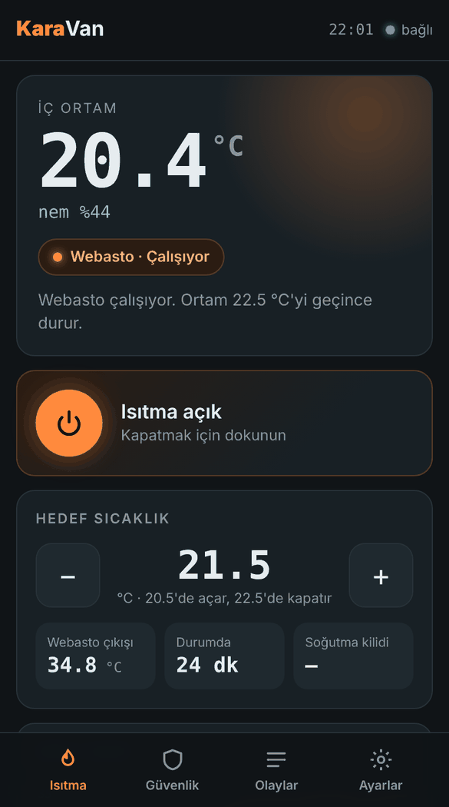
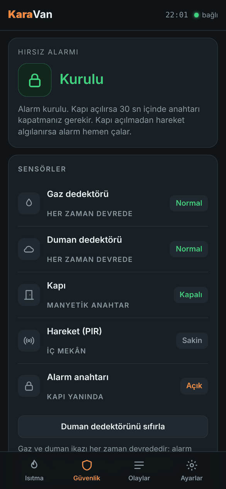
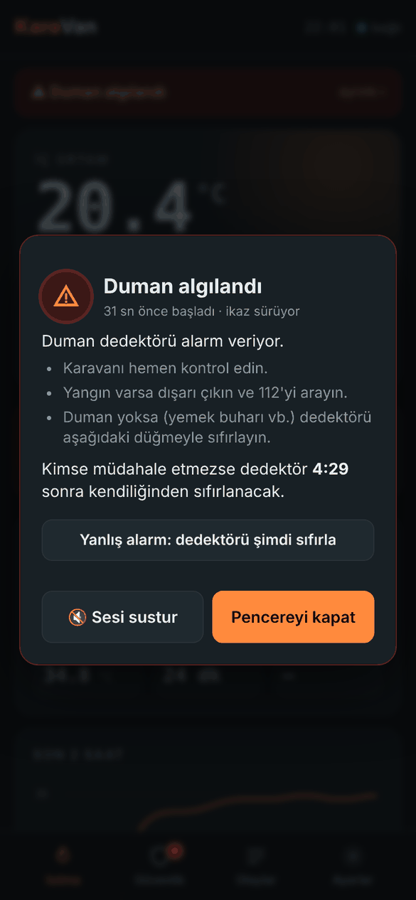

# KaraVan · Karavan Kontrol Paneli

ESP32-S3 tabanlı karavan kontrol kartı: Webasto ısıtıcıyı otomatik çalıştırır, gaz, duman ve hırsız alarmlarını izler. Kart kendi Wi-Fi ağını yayınlar; telefondan tarayıcıyla ya da Android uygulamasıyla yönetilir.

  

## 📖 Kullanım kılavuzu

**[Resimli kullanım kılavuzunu indir (PDF)](KULLANIM_KILAVUZU.pdf)** · [Sayfada oku](KULLANIM_KILAVUZU.md)

## Android uygulaması

**Releases** bölümünden en yeni `KaraVan.apk` dosyasını indirip telefona kurun. Kurulum ve bildirim ayarları için kılavuzun [7. bölümüne](KULLANIM_KILAVUZU.md#7-android-uygulaması-ve-telefon-bildirimleri) bakın.

Uygulama bu depoya `KaraVanApp.zip` yüklendiğinde GitHub tarafından otomatik derlenir.

## Hızlı başlangıç

| | |
| --- | --- |
| Wi-Fi | KaraVan-XXXX · şifre `karavan2026` |
| Adres | http://192.168.4.1 |
| Giriş | `admin` / `karavan` |

İlk girişte giriş şifresini ve Wi-Fi şifresini değiştirin.

---
Kart yazılımı 1.4.0 · Uygulama 1.5
